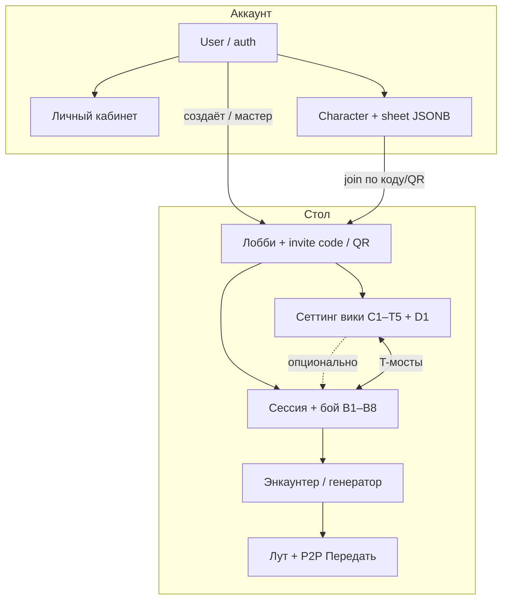
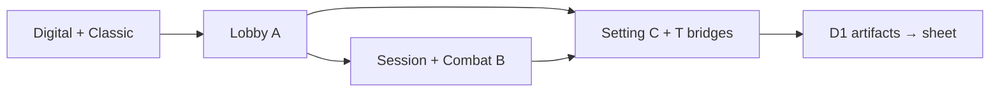

# Dvarf

Свой тулинг для DnD 5e (RU-first). **Не** форк и **не** обёртка над Long Story Short (LSS) — LSS только визуальный/IA-референс.

Цель продукта: быстро вести стол за столом и онлайн — от листа персонажа к общей пачке, подготовке боя и луту.

**North star (срез прода 2026-10-17):**

```text
Лист + classic  →  Лобби (код/QR)  →  Сессия / бой / лут  →  Сеттинг ↔ стол
     (есть)             (есть)              (есть)              (есть)
```

```text
Мои персонажи (аккаунт)
        ↓ код / QR → выбор персонажа
Лобби (создал мастер)
├── Сеттинг (вики C1–T5 + артефакты D1)
└── Сессия (бой B1–B8: инициатива, бестиарий, XP, лут, генератор)
```

Живой срез: [`PRODUCT_STATUS.md`](PRODUCT_STATUS.md) · экосистема: [`ECOSYSTEM_PLAN.md`](ECOSYSTEM_PLAN.md) · сеттинг: [`SETTING_PLAN.md`](SETTING_PLAN.md).  
**Prod tip:** `cursor/name-generation-plan-de51` · http://201.34.132.252/

### Что дальше (не «с нуля»)

| Тема | Статус |
|------|--------|
| C10 карта / C11 граф | по запросу |
| Калибровка генератора (`party_power`) | очередь |
| Лист polish (rich-text, авто-ASI) · classic UX | очередь |
| Стол polish (напарники-стек, mobile чипы) | очередь |

## Для агентов (обязательно прочитать)

**Сначала:** [`AGENTS.md`](AGENTS.md) — жёсткий контракт (анти-overwrite + **UI Kit**).  
**UI Kit (основа фронта):** [`docs/ui-kit/README.md`](docs/ui-kit/README.md) · skill [`.cursor/skills/dvarf-ui-kit/SKILL.md`](.cursor/skills/dvarf-ui-kit/SKILL.md) · доски [`docs/ui-kit/boards/`](docs/ui-kit/boards/).  
Skills: [`.cursor/skills/dvarf-prod-lineage/SKILL.md`](.cursor/skills/dvarf-prod-lineage/SKILL.md) · [`.cursor/skills/dvarf-dev-workflow/SKILL.md`](.cursor/skills/dvarf-dev-workflow/SKILL.md).  
Живой срез фич: [`PRODUCT_STATUS.md`](PRODUCT_STATUS.md).

- Итерации: **короткий план → ok от Игоря → код / commit / push / PR**. Без ok код не писать.
- Ветки: `cursor/<name>-acbe` (от **prod tip**, не от голого `main`/старой развилки). В `main` только через PR.
- **Prod tip сейчас:** `cursor/name-generation-plan-de51` (читай живой VPS / `deploy/prod-tip`, не устаревший README). Деплой только с дерева, где tip уже влит.
- Деплой на Timeweb **только** по явной просьбе («залей на сервер»). `./deploy/sync-and-up.sh` **затирает весь** `/opt/dvarf` кроме `.env` — тонкая ветка убивает чужие фичи. Перед деплоем: `./deploy/preflight-prod.sh`. См. [`deploy/README.md`](deploy/README.md).
- После деплоя: проверить маркеры (лобби, кабинет, лист, classic) на живом сервере; в `PRODUCT_STATUS` писать «на проде» только по факту.
- Параллельные агенты: PR можно параллельно; **на сервер — один интегрированный деплой от tip**. Не деплоить каждый свою развилку.
- Секреты не коммитить. Cloud Agent: `DVARF_SSH_PRIVATE_KEY` = **полный** OpenSSH PEM (`BEGIN`…`END`).
- Каталоги: свой seed + SRD (CC-BY). API TTG недоступен; ждём dnd.su; **чужие сайты не скрейпим**.

## Продуктовые принципы

| Тема | Решение |
|------|---------|
| Роли | Глобальной роли «мастер / игрок» **нет**. Мастер — кто создал **лобби**. |
| Auth | Тонкий: email/password + JWT; OAuth (Yandex/VK) по мере секретов. Биллинг — позже. |
| UI | React mobile-first (позже React Native). Визуал — только по [`docs/ui-kit`](docs/ui-kit/README.md) (Листва → потом темы). |
| Данные листа | Hybrid: summary-колонки + JSONB `sheet` + `sheet_version` (optimistic concurrency, 409). |
| Переиспользование | Чистая логика в `frontend/src/shared/dnd/*` — лист и стол. |

## Карта домена (связи)



## Лобби / сеттинг / сессия

- **Лобби** — место игры. Мастер создаёт → получает **код** и **QR** (`/join/КОД`).
- **Вход игрока:** QR/код → логин → выбрать персонажа; или код на карточке персонажа.
- **Сеттинг** — мир внутри лобби (необязателен).
- **Сессия** — сегодняшний стол; `setting_id` может быть `null` (ваншот). Удаление сеттинга отвязывает сессии.
- Бой и лут — на сессии (**есть**: инициатива, бестиарий, XP, лут, шаблоны, генератор).
- Сеттинг — вики + мосты стол/дневник (**есть**: C1–T5) + артефакты D1.
- Classic 2014/2024 — второй UI того же `sheet`.
- У LSS «комната» ближе к **сессии**, не к сеттингу.
- **Прод:** tip `cursor/name-generation-plan-de51`; nginx проксирует `/lobbies`, `/sessions`, `/settings` на API.

## Дорожная карта (срез прода 2026-10-17)

Детальный статус слайсов: [`ECOSYSTEM_PLAN.md`](ECOSYSTEM_PLAN.md) · [`SETTING_PLAN.md`](SETTING_PLAN.md) · [`PRODUCT_STATUS.md`](PRODUCT_STATUS.md).

| Ось | Содержание | Статус |
|-----|------------|--------|
| Digital sheet | Play Desk, мультикласс, раса→эффекты, заклинания, инвентарь | ✅ прод · polish: rich-text, авто-ASI |
| Classic | Бланк 2014/2024, тот же sheet | ✅ прод |
| Лобби (A1–A6) | Хаб, состав, дневник, чаты, заметки, видимость | ✅ прод |
| Бой (B1–B8) | Противники, инициатива, XP, лут, P2P, шаблоны, генератор | ✅ прод · калибровка `party_power` |
| Сеттинг (C1–T5) | Вики + типы/mentions/секреты + мосты стол↔дневник | ✅ прод · C10/C11 по запросу |
| Артефакты (D1) | Библиотека способностей → лут → лист | ✅ прод |
| Имена | Пол + генерация по расе на создании | ✅ прод |



## Статус кода (сейчас)

Уже в продуктовой ветке / на проде:

- Auth (register/login/refresh, auto-refresh на 401), cabinet profile
- Characters CRUD, hybrid JSONB + `sheet_version` (409)
- Catalogs: races / classes / weapons / items / spells / conditions (+ seeds)
- Sheet: identity (+ XP/subclass/background/alignment), abilities, saves, skills
- Attacks, sticky combat, multi-tab BroadcastChannel sync
- Text blocks + reorder; inventory + weight
- Spells S1–S4; Play S1–S2; Sheet S3 passives/proficiencies
- Sheet S4+: pact magic, attunement (max 3), short-rest hit-die heal
- **Лобби / сеттинг / сессия (каркас):** create lobby, invite code + QR, join с выбором персонажа, код на карточке, сеттинг (опционально), сессия (ваншот или с сеттингом), seat/unseat из лобби
- Alembic head на проде: `c9d0e1f2a3b4` (lobbies/settings/sessions)
- Prod Docker deploy (Timeweb)

Прод: http://201.34.132.252/ — подробности в [`deploy/README.md`](deploy/README.md).  
PR этого слайса: https://github.com/igorpogulaev485-code/Dvarf/pull/18 (`cursor/lobby-join-table-3333`).

## Очередь ближайших слайсов

1. Боевой фрейм на сессии (инициатива / статусы стола) — план → ok  
2. Classic PDF-like — параллельный агент (тот же sheet)  
3. Encounter prep → loot  

Backlog (не начинать без плана): multiclass; race → эффекты на лист; rich-text в блоках; onboarding → тема UI; phone/SMS login; Google OAuth (гео-ограничения для RF); открыть сеттинг игрокам; QR polish / срок жизни кода.
## Стек

- Frontend: React + Vite (`src/ui`, `src/features`, `src/pages`, `src/shared`)
- Backend: Python + FastAPI (REST)
- DB: PostgreSQL + Alembic
- Auth: email/password + JWT; OAuth Yandex/VK — по секретам

## Репозиторий и деплой

- Ветки `cursor/<name>-eb8e`; после слайса: commit → push → обновить PR
- Не коммитить `.env` с ключами (только `.env.example` / `.env.prod.example`)
- Деплой: `./deploy/sync-and-up.sh` (нужен SSH; Cloud Agent — secret `DVARF_SSH_PRIVATE_KEY`)

Основной PR разработки: открытые PR в репо (обычно auth/sheet ветка).

## Backend (локально)

```bash
docker compose up -d db
cd backend
python3 -m venv .venv
source .venv/bin/activate
pip install -r requirements.txt
cp .env.example .env
alembic upgrade head
uvicorn app.main:app --reload --port 8000
```

Auth: `POST /auth/register|login|refresh|logout`, `GET /auth/me`, OAuth stubs/start.  
Characters / catalog — `/characters`, `/catalog`.  
Lobbies / settings / sessions — `/lobbies`, `/lobbies/join`, `/settings/{id}`, `/sessions/{id}` (+ seats).

## Frontend (локально)

```bash
cd frontend
npm install
npm run dev
```

Dev UI: `http://127.0.0.1:5173` (Vite проксирует API на `:8000`).
