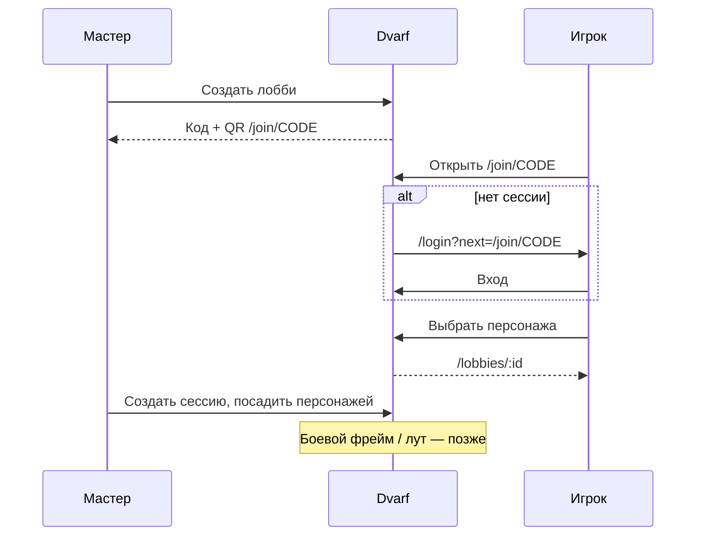

# Dvarf — user flow продукта

Единая карта путей пользователя. Источник правды по фичам на сервере — [`PRODUCT_STATUS.md`](PRODUCT_STATUS.md) в **prod tip**; этот файл описывает **как человек ходит по продукту**, а не статус деплоя.

Прод: http://201.34.132.252/  
Карта собрана по tip-линии (`frontend/src/App.tsx`, `docs/create-pipeline.md`, `docs/guided-onboarding-wizard.md`, `PRODUCT_STATUS.md`).  
Ветка `main` в GitHub — упрощённый SPA-каркас (localStorage), **не** этот flow.

---

## 1. Что это за продукт

**Dvarf** — веб-приложение для игроков и мастеров D&D: аккаунт, создание и ведение персонажа (цифровой лист + классический печатный 2014), игровой стол на листе, лобби/сессии за общим столом.

Стек на проде: React + FastAPI + PostgreSQL (Docker на Timeweb).

---

## 2. Роли

| Роль | Кто | Что делает |
|------|-----|------------|
| **Игрок** | Любой залогиненный | Регистрация, кабинет, персонажи, лист, вход в лобби своим персонажем |
| **Мастер лобби** | Владелец лобби (`owner`) | Создаёт лобби, код/QR, состав, сеттинг, сессии, посадку за стол |
| **Участник лобби** | Не-владелец | Входит по коду, видит состав; без master-действий |
| **Админ** | Отдельная ветка `/admin` | Статистика аккаунтов, смена email вручную — не ядро tip-роутов |

Отдельного «приложения мастера» нет: инструменты мастера — экраны лобби / сеттинга / сессии.

---

## 3. Карта экранов (маршруты)

| Маршрут | Экран | Доступ | Зачем |
|---------|-------|--------|-------|
| `/` | редирект | публичный | → `/characters` или `/login` |
| `/login` | Вход / регистрация | публичный | email+пароль, OAuth Яндекс (VK — заглушка), `?next=` |
| `/verify-email` | Подтверждение email | публичный | активация аккаунта → персонажи |
| `/reset-password` | Новый пароль | публичный | ссылка из SMTP |
| `/confirm-email` | Подтверждение смены email | публичный | → кабинет или логин |
| `/join`, `/join/:code` | Вход в лобби | публичный* | код/QR; без токена — логин с `next` |
| `/characters` | Мои персонажи | auth | список, создать, открыть |
| `/characters/create[/:id]` | Пайплайн создания 2014 | auth | черновик / готово |
| `/characters/:id` | Цифровой лист / play desk | auth | игра, rest, каст, лобби-код |
| `/characters/:id/classic` | Классический лист 2014 | auth | печать; тот же документ, автосейв |
| `/lobbies` | Список лобби | auth | создать / открыть |
| `/lobbies/:id` | Хаб лобби | auth | код, QR, состав, сеттинг, сессии |
| `/settings/:id` | Сеттинг (мир) | auth | необязательные заметки мира |
| `/sessions/:id` | Сессия («этот раз») | auth | посадка персонажей; бой/лут — ⚠️ нет |
| `/cabinet` | Личный кабинет | auth | профиль, аватар, пароль, сессии, удаление |

Шапка (`AppHeader`): **Персонажи** | **Лобби** · аватар/ник → кабинет.

---

## 4. Сквозной путь (happy path)

```mermaid
flowchart TD
  A[Открыл сайт /] --> B{Есть токен?}
  B -->|нет| L[/login]
  B -->|да| C[/characters]
  L --> R[Регистрация + ник]
  R --> V[/verify-email]
  V --> C
  L --> C
  C --> CR{Создать?}
  CR -->|2014| P[/characters/create]
  CR -->|2024| S[/characters/:id + wizard]
  P --> S
  S --> CL[/characters/:id/classic]
  C --> LB[/lobbies]
  LB --> LD[/lobbies/:id]
  LD --> SE[/sessions/:id]
  J[/join/CODE] --> L
  J --> LD
  C --> CAB[/cabinet]
```

---

## 5. Flow по сценариям

### 5.1 Аккаунт

1. `/` → нет сессии → `/login`.
2. **Регистрация:** email + пароль + обязательный никнейм → письмо → `/verify-email` → `/characters`.
3. **Вход:** email + пароль (показать/скрыть); опционально Яндекс.
4. **Забыл пароль:** запрос на логине → SMTP → `/reset-password`.
5. **Кабинет** `/cabinet`: имя / ФИО / телефон, аватарка, смена email/пароля, сессии устройств (одна / остальные / везде), удаление аккаунта.
6. Смена email → `/confirm-email`.

### 5.2 Персонажи: список → создание → лист

1. `/characters` — «Мои персонажи»; черновики с меткой и «Продолжить создание».
2. **Создать** → выбор редакции:
   - **2014** → `/characters/create` (отдельный пайплайн).
   - **2024** → создание через API → `/characters/:id` с guided wizard на листе (`background-first`).
3. Готовый персонаж → цифровой лист; с листа / карточки → **классический** `/characters/:id/classic`.
4. Данные на сервере; автосейв + конфликт версий при двух вкладках.

#### Пайплайн создания 2014 (`/characters/create`)

Порядок шагов ([`docs/create-pipeline.md`](docs/create-pipeline.md)):

1. **Раса** — карточки, поиск/источник, имя, подраса/гранты (ASI, языки…).
2. **Черта** — только если раса даёт `featNoteRu`; иначе шаг скрыт.
3. **Предыстория** — карточки + грант фона.
4. **Класс** + сразу setup (навыки / инструменты / снаряжение или золото).
5. **Характеристики** — вручную / стандартный массив / point buy; расовые бонусы сверху.
6. **Прокачка** — HP, архетип в GuidedWizard, ASI/expertise, мультикласс, заклинания, расовые условные эффекты.

Черновик: localStorage `dvarf.createPipeline.v2` + «Сохранить черновик» → БД `is_draft`.  
**Готово** → `is_draft=false` → цифровой лист (жёсткие гейты: имя, статы, class setup, архетип/ASI/expertise по уровню).

#### Guided wizard (create 2024 + level-up)

Один диалог с очередью шагов ([`docs/guided-onboarding-wizard.md`](docs/guided-onboarding-wizard.md)): фон → класс → развилки уровня → раса → черта*; «Позже» оставляет бейдж. Level-up использует тот же движок.

### 5.3 Игра на цифровом листе (play desk)

Экран `/characters/:id` — основной игровой контур.

**Кейсы K1–K28 + пошаговые микро-флоу** — [`PLAY_DESK_MICROFLOWS.md`](PLAY_DESK_MICROFLOWS.md)  
(снято с tip: `mobile-play-desk-2c91` и Wave A `wave-a-listva` / `desk-vitals`; пометки **[MOB]** / **[WAVE]**).

| Зона | Типовые кейсы |
|------|----------------|
| Режимы стола | K1–K2: Бой / Исслед. / Общение / Напарники (+ WAVE: Способности, ЕЩЁ) |
| Vitals / смерть / концентрация | K3–K5 |
| Отдых | K6, K15 |
| Атаки и расходники | K7, K26 |
| Инвентарь / КД / attune | K8–K11, K27 |
| Заклинания | K12–K14 |
| Level-up / архетип / гранты | K16–K18 |
| Напарники, тексты, аватар | K19–K21 |
| Лобби с листа, sync, classic | K22–K24 |
| Броски навыков, чародейство | K25, K28 |

Кратко по chrome:

- **≥960px** — desk (колонка характеристик + сцена); **&lt;960px** — mobile.
- MOB: sticky боевой статус + ручное **Сохранить лист**.
- WAVE: шапка vitals (**Отдых**, pad хитов/монет), autosave, compact-сцены.

### 5.4 Лобби и стол (мастер + игроки)

**Мастер**

1. `/lobbies` → создать лобби → становится owner.
2. `/lobbies/:id` — код + QR `/join/CODE`, переименование/удаление, свои персонажи в составе, сеттинг, сессии.
3. `/settings/:id` — опциональные заметки мира.
4. `/sessions/:id` — посадка / снятие персонажей из состава лобби.  
   ⚠️ Общий бой (инициатива, фрейм) и лут — **ещё нет**.

**Игрок**

1. Скан/ссылка `/join/:code` (или `/join` + ввод кода).
2. Без логина → `/login?next=…` → обратно на join.
3. Выбор своего персонажа → вход → `/lobbies/:id`.
4. Альтернатива: код с карточки/листа персонажа.



### 5.5 Каркас на `main` (не прод)

Только localStorage:

1. `/` — список → «+ Новый персонаж».
2. `/characters/:id` — карточка полей.
3. `/characters/:id/sheet` — лист для печати.

Auth, кабинет, create pipeline, play desk, лобби — **отсутствуют**.

---

## 6. Навигация (что кликает пользователь)

```
Вход ──► Персонажи ──┬── Создать (2014|2024) ──► Лист ──┬── Classic
                     │                                  └── Код лобби
                     ├── Открыть существующего
                     └── Черновик → Продолжить создание

Шапка: Персонажи | Лобби | (аватар → Кабинет)

Лобби ──► Деталь ──┬── QR / код
                   ├── Сеттинг (опц.)
                   └── Сессия (посадка)
```

---

## 7. Ещё не в flow (осознанные дыры)

| Зазор | Статус |
|-------|--------|
| Боевой фрейм сессии (инициатива, общий бой) | нет |
| Лут / выдача опыта мастером | нет |
| Полная форма создания 2024 как у 2014 | 2024 на листе + wizard |
| VK OAuth | кнопка-заглушка |
| Отдельный DM-инструментарий (вики, состояния пати) | backlog (`IDEAS.md`) |

Ближайшая очередь из статуса продукта: session combat frame → rich-text → encounter prep / loot.

---

## 8. Где смотреть в коде (prod tip)

| Что | Путь |
|-----|------|
| Роутер | `frontend/src/App.tsx` |
| Auth gate | `frontend/src/shared/auth/RequireAuth.tsx` |
| Шапка | `frontend/src/features/characters/AppHeader.tsx` |
| Create 2014 | `frontend/src/pages/CreateCharacterPage.tsx`, `frontend/src/features/createPipeline/*` |
| Цифровой лист / desk | `frontend/src/pages/CharacterDetailPage.tsx`, `MinimalSheetEditor` / `PlayDesk*` |
| Микро-флоу листа (шаги, RU-лейблы) | [`PLAY_DESK_MICROFLOWS.md`](PLAY_DESK_MICROFLOWS.md) |
| Спеки создания | `docs/create-pipeline.md`, `docs/guided-onboarding-wizard.md` |
| Что на проде | `PRODUCT_STATUS.md` |
| Контракт деплоя | `AGENTS.md` |

---

## 9. Как обновлять этот файл

После изменения пользовательского пути (новый экран, смена порядка create, новые роли):

1. Обнови соответствующий сценарий в §5 и таблицу маршрутов в §3.
2. Не дублируй сюда «на проде: да/нет» — это зона `PRODUCT_STATUS.md`.
3. Если tip сменился — поправь ссылку в шапке файла при следующем касании tip-доков.
